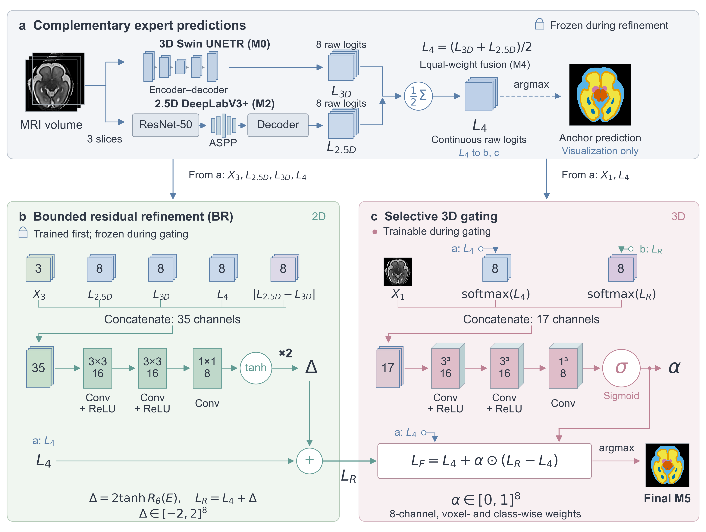
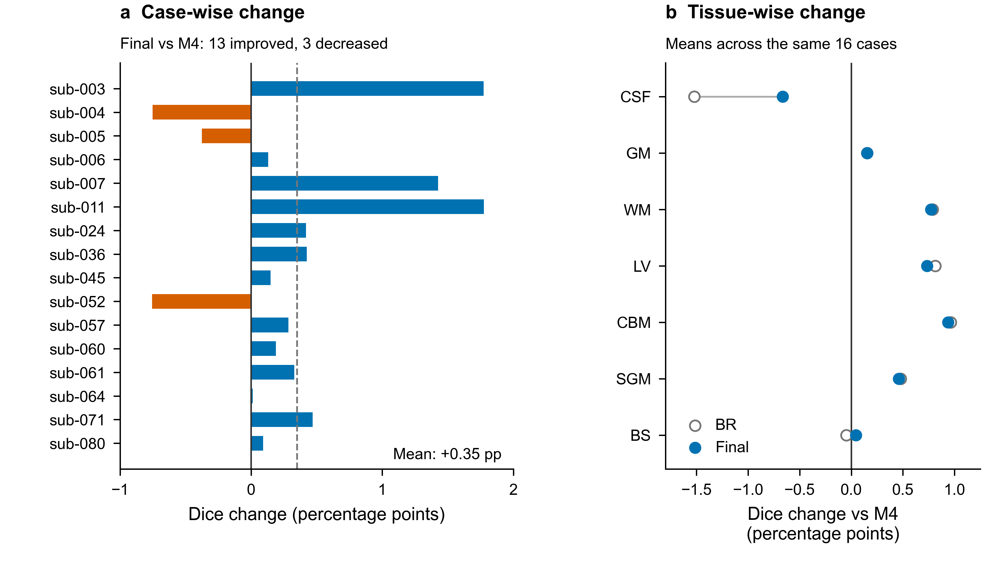
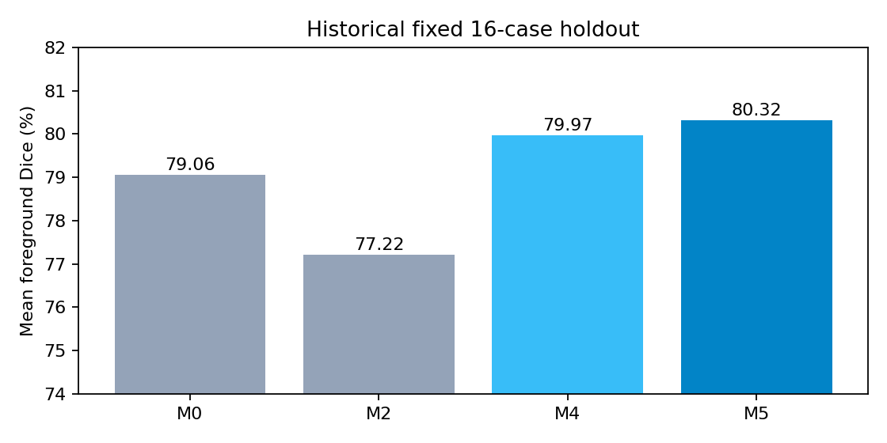

# FeTARefine · 胎儿脑 MRI 分割融合与精炼

基于 80 例胎儿脑 T2 MRI，研究 3D 与 2.5D 分割输出的融合，以及二维有界残差和三维逐体素门控的增量收益。预测包含背景与 7 类组织。

## 模型框架



原报告框架图展示两路专家预测、二维有界残差与三维选择性门控。

## 方法

`MRI → 3D SwinUNETR / 2.5D DeepLabV3+ → 等权 logits → 二维有界残差 → 三维门控 → 分割标签`

残差输入包含三切片 MRI、两路专家 logits、融合 logits 和专家差异，共 35 通道。门控使用 MRI 与两份八类概率，共 17 通道。冻结专家，分阶段训练精炼模块。

## 历史实验

56/8 例用于开发选轮，64 例重新初始化训练，16 例固定留出评价。按病例等权汇总前景 Dice。

| 方法 | Dice |
|---|---:|
| 单独 3D | 79.06% |
| 单独 2.5D | 77.22% |
| 等权融合 M4 | 79.97% |
| 有界残差 BR | 80.20% |
| 完整 M5 | 80.32% |

完整方案相对单独 3D 提升 1.26 个百分点，相对 M4 提升约 0.35 个百分点。13/16 例较 M4 提升，3 例下降。门控相对 BR 为 11 例提升、5 例下降。M5 的 HD95/ASSD 为 2.1525/0.6160 mm，M4 为 2.1452/0.5932 mm，边界指标存在代价。

`results/per_case.csv` 为历史逐例 Dice 数值，病例重新编号。`results/summary.json` 由该表计算。当前源码是清理后的重训实现，历史指标不代表该版本已完成 GPU 重训。原数据到 PP1 的完整预处理生成器尚缺，需自行准备符合格式的 PP1 数据。

## 逐病例与逐组织分析



图中比较完整方案与 M4 的逐病例差值，以及 BR 和完整方案相对 M4 的逐组织变化。病例等权平均提升约 0.35 个百分点，CSF 仍存在退步。结果来自固定划分和训练种子。



## 快速开始

Python 3.10+，先创建虚拟环境。

```bash
python -m pip install torch numpy
python demo.py
```

演示使用真实精炼模块，验证合成张量前向、残差上限、门控范围与反传。完整训练依赖与命令见下方。

```bash
python -m pip install -r requirements.txt
python train.py --help
```

[完整训练、数据结构与评价协议](docs/TRAINING.md)

## 目录

- models / configs，模型与参数配置。
- data / training / inference.py，数据加载、训练与推理。
- evaluation，原空间分割指标。
- results / assets，历史数值与展示图。
- tests，原工程合成检查。

## 开发与来源

本人在 AI 辅助下完成研究与工程整理。MONAI、torchvision 与 Diff-UNet 等第三方来源见 [署名说明](THIRD_PARTY.md)。真实医学影像与权重由使用者按数据许可自行准备。
